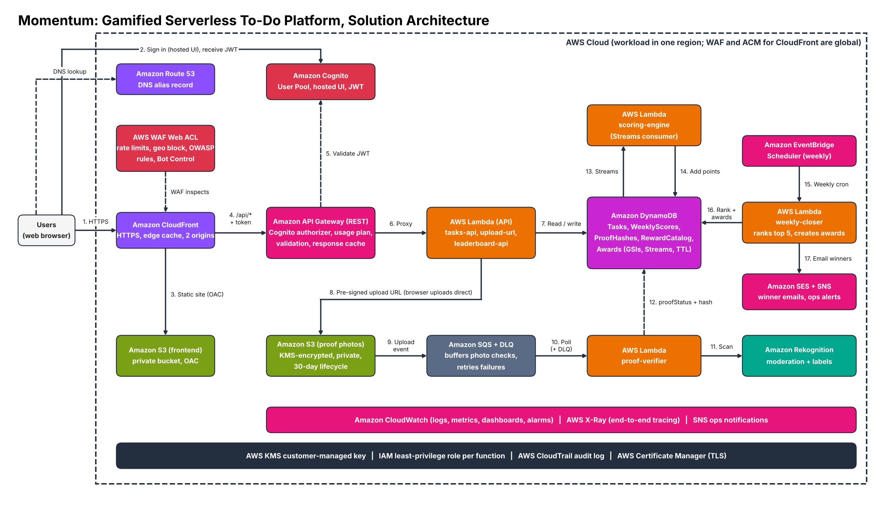

# Momentum: a gamified, serverless to-do platform

**AWS Solutions Architect Associate (SAA-C03) graduation project, Project 3: Serverless REST API with Cognito Auth, DynamoDB and WAF**
**Author:** George Boulus

Momentum is a to-do application that rewards **consistency and honesty**, not just volume. Users complete tasks, optionally attach a proof photo, earn points, and compete on a weekly leaderboard. The top 5 each week receive rewards. The whole backend is serverless and built around the services listed in the Project 3 brief, plus a few extensions that solve real problems of a competitive app (cheating, privacy, weekly automation).

> **Project status:** this repository documents the **solution architecture design**. The infrastructure is not deployed, and a live deployment is optional for this program. The code in `src/` is a reference implementation that shows how each function would work. Its logic is covered by offline unit tests (`tests/`, standard library only, boto3 replaced by small stand-ins), and the React frontend in `frontend/` builds and was exercised against a mock API. Nothing has been run against a live AWS account.

---

## 1. The idea

**Problem.** Most to-do lists are passive. They store tasks but do nothing to help people follow through, and apps that reward volume are easy to game (tick many tiny tasks).

**Solution.** Momentum turns follow-through into a weekly competition with rules that are hard to cheat:

| Event | Points |
|---|---|
| Completing a task (eligible) | +10 |
| Time estimate was accurate (actual within ±20% of estimate) | +5 (within ±50%: +2) |
| Proof photo approved | +5 |
| First scored task of the day (consistency) | +3 |

**One clock for everything.** Days (the daily cap and the daily bonus) and weeks (the leaderboard) are all measured in `Africa/Cairo` local time (`APP_TIMEZONE`, which includes Egypt's daylight saving time). A week runs Monday 00:00 to Sunday 24:00 Cairo time.

A task is **eligible** only if it was actually worked on (started, and at least 2 minutes of active time) and the user has not passed the daily cap of 10 scored tasks. Proof photos are checked for duplicates and unsafe content.

**Weekly rewards (illustrative).** Rank 1: one month of a food subscription. Ranks 2 and 3: one month of an AI email-assistant subscription. Ranks 4 and 5: a champion badge and a partner discount code. These rewards are examples of what sponsors could provide. No partner agreements exist.

**Positioning (honest).** Gamified task apps already exist (for example Habitica), and so do apps that nudge you about postponed tasks. Momentum's design hypothesis is the *combination*: proof-of-completion photos, scoring that rewards accurate estimates and daily consistency rather than raw task counts, and a weekly leaderboard with real-world sponsor rewards. This is a design hypothesis, not a validated result.

## 2. Solution architecture diagram



## 3. Traceability to the Project 3 brief

| Requirement in the brief | How the design meets it | Where |
|---|---|---|
| REST API on API Gateway | Regional REST API, 11 routes | §7, `docs/openapi.yaml` |
| Cognito JWT authorizer | Cognito User Pool authorizer on every method | §4 flow 1, §9 |
| Usage plans | Usage plan with rate, burst and daily quota, attached to the `prod` stage | §7 |
| Response caching | Stage cache on `GET /leaderboard` (60 s) and `GET /rewards` (300 s) | §7 |
| Cognito sign-up, sign-in, hosted UI, JWT | User Pool with email verification, hosted UI (authorization code + PKCE), optional MFA | §4 flow 1 |
| Lambda CRUD handlers, environment variables, IAM roles | 6 functions, each configured through environment variables and its own least-privilege role | §5, §9 |
| DynamoDB table design with GSIs | 5 tables, 3 GSIs, access patterns listed | §6 |
| DynamoDB on-demand capacity | All tables use on-demand capacity | §6 |
| DynamoDB Streams | Stream on `Tasks` drives the scoring engine | §4 flow 5, §6 |
| WAF rate-based rules | Global and per-path rate limits | §9 |
| WAF geo blocking | Geo allow-list on launch markets | §9 |
| WAF OWASP managed rule set | Core rule set, known bad inputs, SQL injection rule group | §9 |
| WAF bot protection | AWS WAF Bot Control (common level) | §9 |
| CloudFront in front of API Gateway | One distribution with two origins: S3 (site) and API Gateway (`/api/*`) | §4, diagram |
| X-Ray tracing across API GW → Lambda → DynamoDB | Active tracing on API Gateway and all Lambdas, with the AWS SDK instrumented | §10 |
| S3 + CloudFront static frontend | Private bucket, Origin Access Control | §4 flow 1 |
| Deliverable: architecture diagram | `architecture.png` | §2 |
| Deliverable: documentation in README | This file | all |

| Learning outcome in the brief | Where it appears |
|---|---|
| Token-based authentication with Cognito and API Gateway authorizers | §4, §9 |
| DynamoDB schemas and GSIs for efficient access patterns | §6 |
| WAF rules against abuse and injection | §9 |
| X-Ray across a serverless call chain | §10 |
| API Gateway caching to reduce Lambda invocations and cost | §7, §11 |
| DynamoDB Streams for downstream processing | §4 flow 5, §6 |

## 4. How it works (request flows)

**Flow 1: opening the app and signing in.** The user's browser resolves the domain through Route 53 and connects to CloudFront over HTTPS (ACM certificate). WAF inspects the request. CloudFront serves the static React/Vue app from a private S3 bucket through Origin Access Control. The app redirects to Cognito's hosted sign-in page (authorization code flow with PKCE) and receives JWT tokens.

**Flow 2: creating and doing a task.** The app calls `/api/tasks` through CloudFront with the Cognito token in the `Authorization` header. API Gateway validates the token and request body, then invokes `tasks-api`, which stores the task in DynamoDB. `POST /tasks/{id}/start` records the start time. `POST /tasks/{id}/complete` records the actual duration and decides whether the task is eligible for points.

**Flow 3: proof photo.** The app asks `upload-url` for a 5-minute pre-signed POST (JPEG only, 1 KB to 5 MB). The browser uploads the photo **directly** to the private, KMS-encrypted proof bucket.

**Flow 4: photo verification.** The S3 upload event goes into an SQS queue (with a dead-letter queue). `proof-verifier` computes the photo's SHA-256 and rejects duplicates with a conditional write, rejects unsafe content with Amazon Rekognition moderation, and requires at least one recognized label. It then marks the task `approved` or `rejected`. Rejected photos are deleted.

**Flow 5: scoring.** Every change to a completed task appears on the DynamoDB Stream. `scoring-engine` calculates the task's total points and adds only the difference to the user's weekly score, in one DynamoDB transaction, so replays never double-count.

**Flow 6: weekly rewards.** EventBridge Scheduler runs `weekly-closer` every Monday at 00:05 (Africa/Cairo), just after the week it closes has ended, so completions made late on Sunday are still counted. The closer ranks the week that just ended. It ranks the top 5, writes one award per winner (a conditional write, so re-runs are safe), emails winners through SES, and sends a summary to an SNS topic for operators.

## 5. AWS services

**Required by the brief**

| Service | Role in Momentum |
|---|---|
| Amazon API Gateway (REST) | Entry point for the API: Cognito authorizer, request validation, usage plan, stage cache |
| Amazon Cognito | Sign-up, sign-in, hosted UI, JWT tokens |
| AWS Lambda | `tasks-api`, `upload-url`, `leaderboard-api`, `proof-verifier`, `scoring-engine`, `weekly-closer` |
| Amazon DynamoDB | All application data, with GSIs, on-demand capacity and Streams |
| AWS WAF | Rate limiting, geo blocking, OWASP rules, bot protection |
| Amazon CloudFront | Single HTTPS entry point with two origins |
| Amazon S3 | Static frontend bucket (and the proof photo bucket) |
| AWS X-Ray | Distributed tracing |

**Extensions (each solves a specific problem)**

| Service | Problem it solves |
|---|---|
| Amazon S3 (proof bucket) + pre-signed POST | Photo uploads without routing large files through API Gateway or Lambda |
| Amazon SQS + DLQ | Buffers photo checks and retries failures instead of losing them |
| Amazon Rekognition | Blocks unsafe photos and obvious non-photos |
| Amazon EventBridge Scheduler | Runs the weekly close without a server |
| Amazon SES and SNS | Winner emails and operational alerts |
| AWS KMS | Customer-managed key for photos and tables |
| Amazon CloudWatch and AWS CloudTrail | Monitoring, alarms and an audit trail |
| Amazon Route 53 and AWS Certificate Manager | Custom domain and TLS certificate |

## 6. Data model (DynamoDB, on-demand capacity)

| Table | Key | Purpose |
|---|---|---|
| `Tasks` | PK `userId`, SK `taskId` | One item per task (title, estimate, status, timestamps, proof status, points) |
| `WeeklyScores` | PK `weekId` (for example `2026-W47`), SK `userId` | Points per user per week, plus small "day marker" items |
| `ProofHashes` | PK `sha256` | Detects duplicate photos. TTL deletes entries after 90 days |
| `RewardCatalog` | PK `rank` | Reward for ranks 1 to 5 |
| `Awards` | PK `userId`, SK `weekId` | Awards issued to each user |

**Global secondary indexes**

| Index | Keys | Use |
|---|---|---|
| `Tasks`: `userId-createdAt-index` | `userId` + `createdAt` | List a user's tasks newest first |
| `Tasks`: `userId-completedAt-index` (sparse) | `userId` + `completedAt` | Count tasks completed today for the daily cap. Only completed tasks appear |
| `WeeklyScores`: `weekId-points-index` | `weekId` + `points` | Leaderboard: top 5 of a week, highest first. Day markers have no `points`, so they never appear |

**Access patterns**

| Pattern | Operation |
|---|---|
| List my tasks | `Query` `Tasks`, `userId = me` |
| Start, complete, edit a task | `UpdateItem` with conditions on `status` |
| Count my completed tasks today | `Query` on `userId-completedAt-index`, `Select = COUNT` |
| Weekly top 5 | `Query` on `weekId-points-index`, descending, limit 5 |
| My rank | `GetItem` on my score, then `Query` with `points > mine`, `Select = COUNT` |
| Add points safely | `TransactWriteItems`: mark the task as scored and add points to the weekly score atomically |
| First task of the day bonus | Conditional `Put` of a day marker, in the same transaction |
| Duplicate photo | Conditional `PutItem` with `attribute_not_exists(sha256)` |

**Scaling note.** The leaderboard index uses one partition key per week. That is fine for a school-scale app. At a very large scale the key would be sharded (for example `weekId#0` to `weekId#9`), with each shard queried for its top 5 and merged.

**DynamoDB Streams** are enabled on `Tasks` (new image). The event source mapping filters for `status = done`, so the scoring engine only sees completed tasks.

## 7. API

| Method and path | Purpose | Lambda | Cache |
|---|---|---|---|
| `GET /tasks` | List my tasks | tasks-api | No |
| `POST /tasks` | Create a task | tasks-api | No |
| `PUT /tasks/{id}` | Edit title or estimate (only before the task is started, so the estimate cannot be adjusted to match the real time) | tasks-api | No |
| `DELETE /tasks/{id}` | Delete a task | tasks-api | No |
| `POST /tasks/{id}/start` | Start working | tasks-api | No |
| `POST /tasks/{id}/complete` | Finish the task | tasks-api | No |
| `POST /tasks/{id}/proof-url` | Get a pre-signed upload | upload-url | No |
| `GET /leaderboard` | Top 5 of a week | leaderboard-api | 60 s, key: `week` |
| `GET /leaderboard/me` | My points and rank | leaderboard-api | No (per user) |
| `GET /rewards` | Reward catalog | leaderboard-api | 300 s |
| `GET /awards/me` | My awards | leaderboard-api | No (per user) |

- **Authentication:** every method uses the Cognito User Pool authorizer.
- **Request validation:** JSON schema models reject malformed bodies before Lambda runs.
- **Usage plan (illustrative):** 50 requests per second, burst 100, quota 100,000 requests per day. An API key in the frontend is used for aggregate throttling only. It is not a security control.
- **Caching:** only data that is identical for every user is cached. Per-user responses are never cached, so one user can never receive another user's data.
- **CORS:** restricted to the application's domain.

The full specification is in [`docs/openapi.yaml`](docs/openapi.yaml).

## 8. Scoring and fair play

| Threat | Control |
|---|---|
| Ticking many trivial tasks | Daily cap of 10 scored tasks, minimum 2 minutes of active time |
| Instant completion | A task must be started first. Duration is measured by the server, not typed by the user |
| Reusing the same photo | SHA-256 stored with a conditional write |
| Inappropriate photos | Rekognition moderation, rejected photos are deleted |
| Fake or empty photos | At least one recognized label is required |
| Double-counting points | Idempotent scoring in a DynamoDB transaction |
| Automated farming by bots | WAF Bot Control, per-path rate limits, Cognito email verification |
| Showing someone's email publicly | The leaderboard uses a nickname, or `Player-` plus part of the user ID |

## 9. Security design (defense in depth)

**AWS WAF web ACL on CloudFront** (rules in priority order)

| Rule | Purpose |
|---|---|
| Amazon IP reputation list | Blocks known malicious sources |
| Core rule set | OWASP-style protections |
| Known bad inputs | Blocks exploit patterns |
| SQL database rule group | Injection protection |
| Bot Control (common level) | Bot protection |
| Rate-based: all paths | About 300 requests per 5 minutes per IP |
| Rate-based: `/api/tasks/*/complete` and `/proof-url` | Stricter limit of about 20 per 5 minutes per IP |
| Geo match | Allow-list of launch countries, block others |

WAF for CloudFront and the CloudFront certificate are created in `us-east-1`. Everything else runs in the primary region. Bot Control carries an extra fee, so it is enabled with the cost in mind (see §11).

**Least-privilege IAM, one role per function**

| Function | Permissions |
|---|---|
| tasks-api | DynamoDB Get/Put/Update/Delete/Query on `Tasks` and its indexes |
| upload-url | DynamoDB GetItem on `Tasks`, S3 PutObject on `proofs/*`, KMS GenerateDataKey |
| leaderboard-api | DynamoDB Query/GetItem on `WeeklyScores` and its index, Query on `Awards`, Scan on `RewardCatalog` |
| proof-verifier | S3 Get/Delete on `proofs/*`, Rekognition Detect* calls, DynamoDB PutItem on `ProofHashes`, UpdateItem on `Tasks`, SQS receive/delete, KMS Decrypt |
| scoring-engine | Read the `Tasks` stream, UpdateItem on `Tasks`, UpdateItem and PutItem on `WeeklyScores` |
| weekly-closer | Query `WeeklyScores` index, GetItem on `RewardCatalog`, PutItem on `Awards`, Cognito AdminGetUser, SES SendEmail, SNS Publish |

All roles also get CloudWatch Logs and X-Ray write permissions.

**Data protection and privacy**
- **Private buckets only.** The frontend bucket is readable only by CloudFront (Origin Access Control). The proof bucket has Block Public Access on and a policy that denies non-TLS requests.
- **Encryption:** HTTPS everywhere, SSE-KMS for photos, encryption at rest for DynamoDB.
- **Photos are short-lived:** the proof bucket expires objects after 30 days, rejected photos are deleted immediately, and upload URLs expire after 5 minutes.
- **No secrets in code:** services authenticate with IAM roles. Configuration is passed through environment variables.
- **Audit:** CloudTrail records API activity. Point-in-time recovery protects the tables.

## 10. Observability

- **CloudWatch Logs:** every Lambda and API Gateway stage logs structured entries.
- **X-Ray:** active tracing on API Gateway and all Lambdas shows the path API Gateway → Lambda → DynamoDB, plus S3 and Rekognition calls in the photo pipeline.
- **Alarms with SNS email notification:** Lambda errors, API Gateway 5XX responses, any message in the dead-letter queue, a spike in WAF blocked requests, and the age of the oldest SQS message.
- **Dashboard:** request count, latency, error rate, cache hit rate, queue depth, and points awarded per hour.

## 11. Reliability, scalability and cost

| Well-Architected pillar | How the design addresses it |
|---|---|
| Operational excellence | Managed services, structured logs, alarms, tracing, and a documented deployment order |
| Security | Layered controls in §9 |
| Reliability | Multi-AZ managed services, SQS retries with a DLQ, idempotent scoring, conditional writes, DynamoDB point-in-time recovery |
| Performance efficiency | CloudFront edge caching, API Gateway cache for shared data, DynamoDB single-digit millisecond access, automatic scaling |
| Cost optimization | Pay per request everywhere, on-demand tables, photo lifecycle rules, API cache only for shared endpoints |
| Sustainability | No idle servers, short data retention |

**Cost drivers to watch:** WAF (monthly fee per web ACL and rule, plus Bot Control), Rekognition (charged per image analysis), the API Gateway cache (hourly while enabled), and CloudFront data transfer. A budget alarm in AWS Budgets would notify the owner before spending drifts.

## 12. Deployment plan (how this design would be built)

1. Create the KMS key, the DynamoDB tables with GSIs, TTL and Streams, and the reward catalog items.
2. Create the S3 proof bucket (private, SSE-KMS, lifecycle) and the frontend bucket.
3. Create the SQS queue with its DLQ and connect the S3 upload event.
4. Create the six Lambda functions with environment variables and least-privilege roles, and enable X-Ray.
5. Create the Cognito User Pool and an app client (authorization code with PKCE).
6. Create the API Gateway REST API from `docs/openapi.yaml`, attach the authorizer, validation models, usage plan and cache, then deploy the `prod` stage.
7. Create the CloudFront distribution with the S3 and API origins, Origin Access Control, and the ACM certificate.
8. Create the WAF web ACL and attach it to CloudFront.
9. Create the EventBridge schedule, SES identity and SNS topic.
10. Create CloudWatch alarms and the dashboard, and enable CloudTrail.
11. Add a Route 53 alias record to the distribution.

Infrastructure as Code (CloudFormation or AWS SAM) would be the natural next step to make this repeatable.

## 13. Limitations and future work

- The infrastructure is **not deployed**. The Lambda logic has been run only in offline unit tests with stand-ins for AWS, and the frontend only against a mock API. Real behavior of API Gateway, Cognito, WAF, DynamoDB Streams and the other services is design intent until deployed.
- A task's proof photo is final once approved. A later upload for the same task is discarded.
- Rekognition cannot confirm that a photo matches a specific task. It only filters unsafe or empty images, so a determined user could still submit unrelated photos. Human review of top-ranked proofs would be a sensible control before awarding real prizes.
- Rewards are illustrative, and real prizes would need legal terms and sponsor agreements.
- Future ideas: a regional WAF on the API stage as a second layer, DynamoDB Global Tables for multi-region resilience, personal insights such as "you usually need 1.5x your estimate", and team leaderboards.

## 14. Repository structure

```
.
├── README.md
├── architecture.png
├── docs/
│   └── openapi.yaml
├── src/
│   ├── tasks_api.py
│   ├── upload_url.py
│   ├── leaderboard_api.py
│   ├── proof_verifier.py
│   ├── scoring_engine.py
│   └── weekly_closer.py
├── tests/                  offline unit tests (python -m unittest discover -s tests)
└── frontend/               React (Vite) single-page app, sign-in through the Cognito hosted UI
    ├── package.json
    ├── index.html
    └── src/main.jsx        sign-in (PKCE), API client and screens
```

**Run the tests:** `cd tests && python3 -m unittest discover` (Python 3.9 or newer, no packages to install).

**Build the frontend:** `cd frontend && npm install && npm run build`. Set `VITE_COGNITO_DOMAIN` (the hosted UI domain), `VITE_COGNITO_CLIENT_ID` and optionally `VITE_API_URL` (default `/api`, the CloudFront path that forwards to API Gateway) and `VITE_REDIRECT_URI`. Sign-in uses the authorization code flow with PKCE, the ID token stays in memory, and the API is called with it in the `Authorization` header for the Cognito authorizer. Upload the `dist/` folder to the frontend S3 bucket in deployment step 7.
